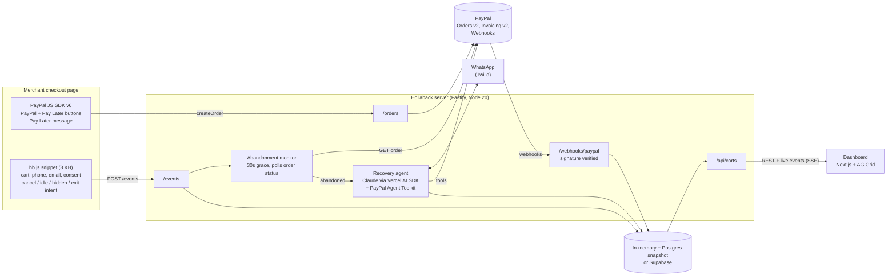

# Hollaback

**One script tag that brings abandoned PayPal checkouts back.**

Most shoppers who start a checkout never finish it. Hollaback watches a merchant's PayPal checkout, notices when a shopper walks away, and messages them on WhatsApp within a minute. An AI agent that already knows their cart answers the objection and sends a one-tap way to finish: the PayPal checkout link, a PayPal Pay Later offer, or a PayPal invoice. The merchant dashboard (AG Grid) shows every abandoned cart, the agent's conversation and tool calls, and recovered revenue ticking up.

```html
<script src="https://<your-hollaback-server>/hb.js" data-merchant="demo" async></script>
```

## The problem

- Around 7 in 10 online checkouts are abandoned. For a PayPal merchant every one of them is a PayPal order that was created and never approved.
- PayPal has no "order abandoned" webhook, so merchants never find out who left or why.
- The usual fix, a reminder email hours later, reaches a shopper who has already moved on. A message within a minute, on the app they actually read, that can answer "it's a bit pricey" with "split it in 4 with Pay Later", lands while they still want the item.

## What it does

1. **Detects abandonment.** The snippet finds the checkout (PayPal buttons, checkout URL, contact fields), captures phone, email and cart, adds a WhatsApp consent checkbox, and reports `checkout_started`, `order_created` and `abandoned` (PayPal popup cancelled, 45 s idle after the order exists, tab hidden 20 s, exit intent).
2. **Confirms it with PayPal.** When an order is created the server starts a 30 s grace timer, then polls `GET /v2/checkout/orders/{id}`. It fires `abandoned` only if the order is still `CREATED` or `PAYER_ACTION_REQUIRED` and the browser signalled abandonment (or the order sat unpaid for 10 minutes). A shopper still typing their PayPal password is never messaged.
3. **Reaches out.** If the shopper opted in, a Claude agent writes to them on WhatsApp (Twilio) with their name, item and total.
4. **Handles the objection with PayPal tools.** Price: offer PayPal Pay Later first, then (only then) a discount capped at 10 % that PATCHes the order. Trust: explain PayPal Purchase Protection and send the PayPal-hosted link. "Just email me": create and send a PayPal invoice. "Stop": end and mark declined.
5. **Marks the recovery.** Verified PayPal webhooks (`CHECKOUT.ORDER.APPROVED`, `PAYMENT.CAPTURE.COMPLETED`, `INVOICING.INVOICE.PAID`) flip the cart to Recovered with the amount, and the dashboard counter ticks up.

## Hosted demo

| Part | URL |
| --- | --- |
| Demo store (checkout page with the snippet) | https://hollaback-demo-store.onrender.com |
| Merchant dashboard | https://hollaback-dashboard.onrender.com |
| API server (`/health`) | https://hollaback-server.onrender.com/health |

**Try it in two minutes, no WhatsApp needed:**

1. Open the demo store and click *Fill in a demo shopper* (it also ticks the WhatsApp consent box).
2. Click *Pay with PayPal* or *Pay Later*, then close the PayPal window without paying.
3. About 30 seconds later the cart appears on the dashboard. Open it: the agent has written to the shopper. Reply with the chips, for example `bit pricey rn` (Pay Later) or `just email me the invoice` (a real PayPal sandbox invoice, created through the PayPal Agent Toolkit).
4. Open the PayPal link or invoice the agent sent, log in as the sandbox buyer below and pay. The cart flips to Recovered on the dashboard within seconds of PayPal's webhook.

The server runs on Render's free tier, so the first request after it has been idle can take about a minute. To drive a full recovery against the hosted server from a clone: `HOLLABACK_API_URL=https://hollaback-server.onrender.com pnpm demo:mock`, then watch the row flip on the dashboard. That script only works while the server runs in mock mode (`/health` shows `"mockPaypal": true`), because it approves the order through the simulated PayPal.

To pay as the shopper on the hosted demo (the PayPal popup, a link the agent sends on WhatsApp, or an invoice), log in with this PayPal **sandbox** buyer. It is a US test account that only holds sandbox money:

| Sandbox buyer | |
| --- | --- |
| Email | `sb-0nvk853708082@personal.example.com` |
| Password | `lyl$I7Pi` |

Skip *Pay with Debit or Credit Card* on the PayPal page; that is guest checkout. Log in with the account above to see PayPal Pay Later.

*Fill in a demo shopper* enters a made-up number, so the agent's conversation for it runs on that cart's dashboard page, where you reply as the shopper. To get it on your own WhatsApp instead, send `join tales-told` to +1 415 523 8886 on WhatsApp, then check out with your own number.

## Try it in 90 seconds (no accounts needed)

Requirements: Node 20+ and pnpm 10 (`corepack enable`).

```bash
git clone https://github.com/big14way/hollaback.git && cd hollaback
pnpm i
pnpm dev:mock        # server :4000, dashboard :3000, demo store :5173
```

In a second terminal:

```bash
pnpm demo:mock
```

`demo:mock` walks one cart through the whole loop against the running server and prints each step:

```
1. Shopper opens the Kicks Lagos checkout
2. Shopper clicks the PayPal button          PayPal order KZ8WTJEEXVV95EJS8 (PAYER_ACTION_REQUIRED)
3. Shopper closes the PayPal popup without paying
4. Server confirms abandonment after the 30s grace period
5. Agent  > Hi Ada, this is Kicks Lagos. Saw you were about to grab the Air Runners ($89.00). Anything holding you back?
6. Shopper> bit pricey rn
   Agent  > No stress. You can split it into 4 interest-free payments with PayPal Pay Later: $22.25 today ...
            http://localhost:4000/mock/paypal/checkoutnow?token=KZ8WTJEEXVV95EJS8
7. Shopper taps the link and approves on PayPal   (CHECKOUT.ORDER.APPROVED, PAYMENT.CAPTURE.COMPLETED)
8. Recovered: $89.00
PASS: created -> abandoned -> agent message -> recovered
```

Then open:

- **Dashboard** at http://localhost:3000: the cart sits in the Recovered group and the recovered revenue counter has ticked up. Click the row for the transcript and the tool-call timeline (inputs, outputs, timings, webhooks).
- **Demo store** at http://localhost:5173: click *Fill in a demo shopper* (it also ticks the consent box), click *Pay with PayPal*, then close the PayPal window. About 30 s later the agent's WhatsApp message prints in the `pnpm dev:mock` terminal and a new row appears on the dashboard without a refresh (it subscribes to the server's live event stream). On that cart's page, use the *reply as shopper* chips: `bit pricey rn` (Pay Later), `still too much tbh` (10 % discount), `just email me the invoice` (PayPal invoice), `STOP` (opt-out). Open the link the agent sent and approve to watch the row flip to Recovered.

Mock mode replaces PayPal with an in-process fake of the Orders v2, Invoicing v2 and Webhooks endpoints. It is plugged in as the `fetch` of the real PayPal client, so the same request-building code runs in mock mode and in the sandbox. Its approval and invoice pages are clearly labelled as simulated.

## Run it against the PayPal sandbox

1. Create a REST app at https://developer.paypal.com/dashboard (Apps & Credentials, Sandbox). Note the client id and secret, and the sandbox personal account under Testing Tools > Sandbox accounts.
2. `cp .env.example .env` and set `PAYPAL_CLIENT_ID` and `PAYPAL_CLIENT_SECRET`.
3. `pnpm paypal:smoke` creates an order (`POST /v2/checkout/orders`) and fetches it (`GET /v2/checkout/orders/{id}`), printing the payer-action link.
4. Expose the server over HTTPS (deploy it, or run a tunnel) and set `SERVER_PUBLIC_URL`. Then `pnpm paypal:webhook` registers `POST /v1/notifications/webhooks` for the four events and prints `PAYPAL_WEBHOOK_ID`. Put it in `.env`.
5. `pnpm dev`. The demo store now renders the real JS SDK v6 PayPal and Pay Later buttons and the Pay Later message. Log in with the sandbox personal account to pay, or close the popup to trigger a recovery.

   PayPal decides Pay Later eligibility from the buyer's country. So that testers outside the US see the Pay Later button and the agent's Pay Later offer, the demo store passes the sandbox-only `testBuyerCountry: "US"` to `createInstance`. Add `?buyerCountry=auto` to the store URL to use your real location instead, or `?buyerCountry=GB` (any two-letter code) to try another country. Paying with Pay Later needs a US sandbox personal account.
6. To exercise the webhook path without a purchase: `POST /v1/notifications/simulate-event` with your `webhook_id` and `event_type: CHECKOUT.ORDER.APPROVED`.

Use your own sandbox personal account to pay locally, or the hosted demo's sandbox buyer listed under [Hosted demo](#hosted-demo).

### WhatsApp (Twilio sandbox)

Set `TWILIO_ACCOUNT_SID`, `TWILIO_AUTH_TOKEN` and `TWILIO_WHATSAPP_FROM` (the sandbox number, `whatsapp:+14155238886`). The shopper's phone must join the Twilio WhatsApp sandbox once by sending its join code. In the Twilio console set "When a message comes in" to `https://<server>/whatsapp/inbound` (POST). Inbound requests are checked against `X-Twilio-Signature`. Without Twilio, messages print in the server console and replies come from the dashboard.

The channel is picked per conversation. Numbers in `CONSOLE_NUMBERS` (by default the demo store's *Fill in a demo shopper* number, +234 803 123 4567, which never joined the sandbox) stay on the console channel even when WhatsApp is on, so their conversation runs in the dashboard's *reply as shopper* box. Every other number gets WhatsApp. To get the hosted demo's conversation on your own phone, send `join tales-told` to +1 415 523 8886 on WhatsApp first, then check out with your own number.

On the Twilio sandbox, `STOP` is Twilio's own keyword: it removes your phone from the sandbox and never reaches Hollaback (the next message fails with error 63015 until you send the join code again). To see the decline path there, reply something like `no thanks, not interested`. With a production WhatsApp sender, `STOP` reaches Hollaback and ends the conversation for good.

### Claude agent

Set `ANTHROPIC_API_KEY`. The agent runs `claude-haiku-5-5` (Claude Haiku 5.5) through the Vercel AI SDK, at effort `medium` (`AGENT_EFFORT`). Without a key the scripted agent runs the same policy with the same tools, so every flow works offline.

### Persistence

By default carts and conversations live in memory and are gone after a restart. Two ways to keep them:

- **Postgres snapshot** (simplest, works with a free Neon database): set `DATABASE_URL`. On boot the server loads the latest snapshot, and about a second after each write it saves the whole store as one jsonb row in `hollaback_snapshot` (created if missing; one row per server URL). If the database can't be reached at boot, the server logs a warning, starts empty and doesn't save that run, so the saved data is never overwritten. `/health` reports `"store": "memory+postgres"` while it is on.
- **Supabase**: set `SUPABASE_URL` and `SUPABASE_SERVICE_ROLE_KEY` and run `supabase/schema.sql` in the SQL editor. It takes precedence over `DATABASE_URL`.

## Deploy to Render (free tier)

[`render.yaml`](render.yaml) is a Render Blueprint for three free services: the API server (web service) and the dashboard and demo store (static sites). Every secret is optional. With none set the hosted server runs in mock mode, exactly like `pnpm dev:mock`.

1. In the Render dashboard choose **New > Blueprint** and select this repository. Leave unknown secrets empty.
2. When the server is live, copy its `https://...onrender.com` URL. Set it as `NEXT_PUBLIC_HOLLABACK_API_URL` on the dashboard site and `HOLLABACK_API_URL` on the demo store site, then redeploy both. These values are baked in at build time.
3. On the server, set `DEMO_STORE_URL` and `DASHBOARD_URL` to the two static site URLs. The server finds its own public URL from Render's `RENDER_EXTERNAL_URL`.
4. With PayPal credentials set, register the webhook once: `pnpm paypal:webhook https://<server>.onrender.com/webhooks/paypal`, then set `PAYPAL_WEBHOOK_ID` on the server.

The free web service sleeps after 15 idle minutes and the first request after that takes about a minute. To keep it awake, set the repository variable `HOLLABACK_SERVER_URL` to the server URL and the `keep-warm` GitHub Actions workflow pings `/health` every 10 minutes. The in-memory store resets when the service restarts or sleeps, so set `DATABASE_URL` to a free Neon Postgres database to keep the demo data (see [Persistence](#persistence)).

## PayPal products used

| Product | Where | Calls |
| --- | --- | --- |
| **JS SDK v6** | `demo-store/` | `window.paypal.createInstance({ clientId, components: ["paypal-payments", "paypal-messages"], pageType: "checkout", testBuyerCountry })`, `findEligibleMethods({ currencyCode, amount })`, `isEligible("paypal" \| "paylater")`, `getDetails("paylater")`, `createPayPalOneTimePaymentSession`, `createPayLaterOneTimePaymentSession`, `session.start({ presentationMode: "auto" }, createOrder())`, `onApprove` / `onCancel` / `onError` |
| **Pay Later** | demo store, agent | `<paypal-pay-later-button>`, `<paypal-message auto-bootstrap>` with `createPayPalMessages`, Pay in 4 offer from the agent |
| **Orders v2** | `server/src/paypal/client.ts` | `POST /v1/oauth2/token`, `POST /v2/checkout/orders` (`user_action: PAY_NOW`, `payer-action` link), `GET /v2/checkout/orders/{id}` (abandonment check), `PATCH /v2/checkout/orders/{id}` (capped discount), `POST /v2/checkout/orders/{id}/capture` |
| **Invoicing v2** | agent tools `create_and_send_invoice`, `send_invoice_reminder` | `POST /v2/invoicing/invoices`, `POST /v2/invoicing/invoices/{id}/send`, `GET /v2/invoicing/invoices/{id}` (`detail.metadata.recipient_view_url` is sent to the shopper), `POST /v2/invoicing/invoices/{id}/remind`; through the Agent Toolkit when credentials are set |
| **Webhooks** | `server/src/routes/webhooks.ts`, `scripts/register-webhook.ts` | `POST /v1/notifications/webhooks`, `POST /v1/notifications/verify-webhook-signature` (raw body embedded verbatim), `POST /v1/notifications/simulate-event`; events `CHECKOUT.ORDER.APPROVED`, `CHECKOUT.ORDER.COMPLETED`, `PAYMENT.CAPTURE.COMPLETED`, `INVOICING.INVOICE.PAID` |
| **PayPal Agent Toolkit** | `server/src/agent/toolkit.ts`, `server/src/agent/invoicing.ts` | `@paypal/agent-toolkit/ai-sdk` tools. Inside Hollaback's guarded tools: `create_invoice`, `send_invoice` and `get_invoice` (`create_and_send_invoice`), `get_order` (`get_order`), `send_invoice_reminder` (the cart's own invoice only, also the 15-minute follow-up). Given to the model as they are: `get_invoice` and `generate_invoice_qr_code`, limited to the cart's invoice. Mock mode uses the REST client instead, which is also the fallback when a toolkit call fails |

## AI tools used

- **Claude Haiku 5.5 (`claude-haiku-5-5`) via the Vercel AI SDK** (`ai` v5, `@ai-sdk/anthropic`). The recovery agent: it reads the conversation, picks tools, and writes short WhatsApp replies. `server/src/agent/llm.ts`.
- **PayPal Agent Toolkit** (`@paypal/agent-toolkit/ai-sdk`). With PayPal credentials set, the agent creates and sends invoices, sends invoice reminders and checks order status through PayPal's own toolkit, and the dashboard marks those calls "via PayPal Agent Toolkit". Every input is checked against the toolkit's own schemas first. The toolkit builds AI SDK v4-style tools (`parameters`), so the ones the model calls directly are re-wrapped with AI SDK v5's `dynamicTool`.
- **Agent tools** (`server/src/agent/tools.ts`), each logged to the transcript with input, output and timing:

| Tool | PayPal call | Guardrail |
| --- | --- | --- |
| `send_checkout_link` | `GET` order, re-create if `VOIDED` | link appended by the server, never typed by the model |
| `offer_pay_later` | Pay in 4 amount + checkout link | only when eligible (US, $30 to $1,500, SDK eligibility) |
| `create_and_send_invoice` | Agent Toolkit `create_invoice`, `send_invoice`, `get_invoice` (Invoicing v2) | needs a valid email; one invoice per cart |
| `send_invoice_reminder` | Agent Toolkit `send_invoice_reminder` (`POST .../remind`) | only the cart's own invoice (the model passes no id), only while unpaid, at most one every 10 minutes |
| `apply_discount` | `PATCH /v2/checkout/orders/{id}` | hard cap 10 %, once per order, only after Pay Later was offered, only while the order is patchable |
| `end_conversation` | none | marks declined or no reply |
| `get_order` | Agent Toolkit `get_order` (Orders v2) | read only, the cart's own order |

When the shopper has an unpaid invoice, the one follow-up after 15 minutes of silence is PayPal's own reminder for that invoice rather than the checkout link again.

Deterministic rules sit outside the model (`server/src/agent/guardrails.ts`): opt-out words (`STOP`, `no`, `unsubscribe` and others) end the chat before the model is called, two unanswered messages end the chat, the discount rules above, and no message is sent without WhatsApp consent.

## Architecture



```
hollaback/
  snippet/      vanilla TS -> esbuild -> dist/hb.js (< 15 KB budget enforced at build)
  server/       Fastify API, PayPal client + in-process mock, abandonment monitor, agent, channels, stores
  dashboard/    Next.js 15 static export + ag-grid-react / ag-grid-community 36: carts grid, transcript page
  demo-store/   static checkout page using the PayPal JS SDK v6
  scripts/      paypal-smoke.ts, register-webhook.ts, demo-mock.ts
  supabase/     schema.sql
```

The dashboard groups carts by outcome with full-width group rows, because AG Grid's built-in row grouping is an Enterprise feature and Hollaback uses only AG Grid Community. It also uses Community's quick filter, a pinned bottom totals row (carts shown, their value and what was recovered, following the filter) and CSV export (`exportDataAsCsv` with readable values: outcome labels, ISO times, plain amounts, how each recovered cart was paid and the PayPal order id).

## Scripts

| Command | What it does |
| --- | --- |
| `pnpm dev:mock` | Server (mock PayPal), dashboard and demo store |
| `pnpm demo:mock` | Scripted cart: created, abandoned, agent message, recovered |
| `pnpm dev` | Same three apps using `.env` (PayPal sandbox when credentials are set) |
| `pnpm check` | Lint, typecheck and tests across all packages |
| `pnpm paypal:smoke` | Create and fetch a sandbox order |
| `pnpm paypal:webhook [url]` | Register the PayPal webhook and print its id |
| `pnpm build` | Build every package |

Tests (Vitest and node:test) cover the checkout detection heuristics and trigger state machine, the grace timer against the PayPal mock (cancel, approve within grace, still in popup, timeout, voided, late cancel, idle), the discount cap and other guardrails, webhook signature request building, Twilio signatures, the outcome grouping, the full recovery loop through the HTTP API (link, Pay Later, discount, invoice, opt-out, no consent, paid normally), the PayPal Agent Toolkit path (inputs checked against the toolkit's own schemas, REST fallback, invoice reminders scoped to the cart), and per-number channel routing.

## Configuration

Every variable is listed with a comment in [`.env.example`](.env.example). Nothing is required for mock mode.

## Licence

[MIT](LICENSE)
